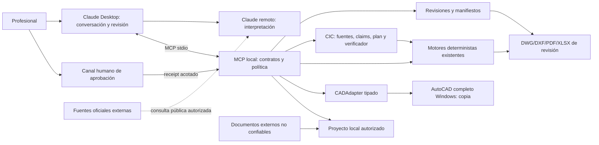
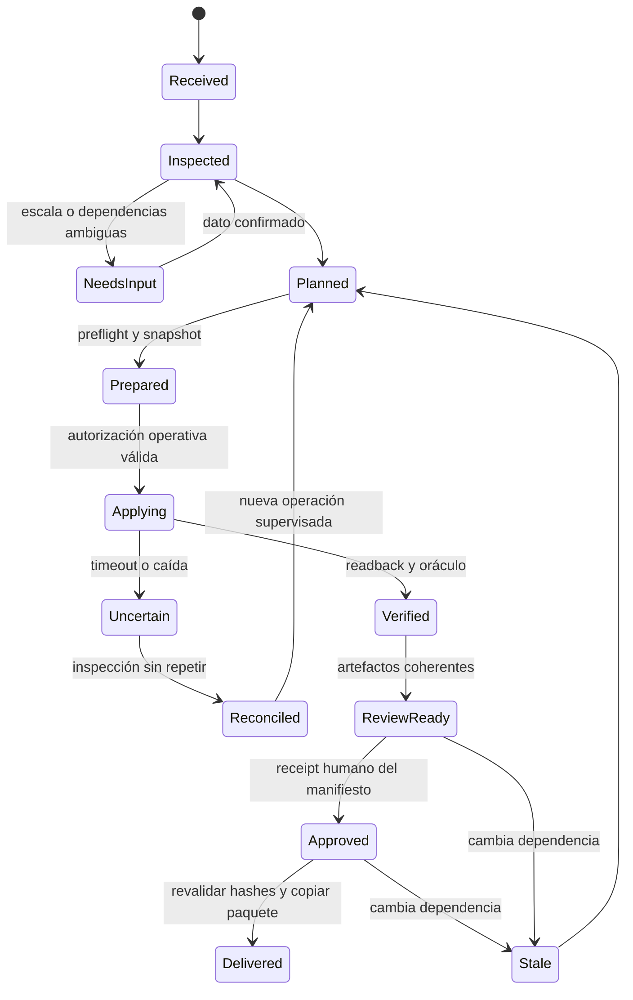

# ASTRA 04 — Diseño integral de producto y sistema

Propuesta de ingeniería 17-11-2026. Base auditada `2f4cdd0`; no cambia producto ni autoriza implementación. Evidencia factual: ASTRA 01; fuentes Rxx: ASTRA 02; prioridades/gates: ASTRA 06. Objetivo: ayudar a Tannia a editar planos, medir y preparar documentación profesional verificable con AutoCAD 2D y 3D geométrico, sin modificar originales ni sustituir responsabilidades profesionales.

## 1. Decisión arquitectónica y alcance

**ADR-A1: núcleo común pequeño y vertical de edificación primero.** El dominio común contiene identidad/revisiones, autorización, mediciones, procedencia, métodos, cambios y entrega. Los métodos de muros, losas, terminaciones y carpinterías se validan primero. Infraestructura lineal/túnel conserva sus implementaciones académicas; no determina el diseño de toda interacción. BIM/IFC, SaaS, frontend propio y motor estructural quedan fuera del desarrollo autorizado.

| Alternativa | Valor observable | Riesgo/coste | Decisión y condición de revisión |
|---|---|---|---|
| Producto solo vivienda nueva | reutiliza design/architect, encargo issue #10 | deja fuera cubicación de planos existentes y obra; reglas rígidas | no elegir como arquitectura, sí como capacidad acotada |
| Núcleo universal de construcción desde cero | promesa de muchas disciplinas | ontología enorme, expertos/licencias/corpus ausentes; duplica CIC | descartar por ahora |
| Núcleo común + expediente de edificación | reutiliza geometría/CIC/APU; conecta trabajo manual a entrega | requiere probar edición de dibujos ajenos y método profesional | recomendado; extender cuando un segundo dominio demuestre qué abstracción falta |
| Integrar solo producto de terceros | adopción rápida si oficina ya lo usa | no resuelve automáticamente normas chilenas ni revisión de archivo; dependencia | comprar complementos puntuales, no reemplazo sin comparación |

Fundamento: issue #10 pide vivienda editable; cantidades/APU y antecedentes están en mandato; la evidencia MOP/ONDAC muestra flujo de expediente, partidas y revisión. No sabemos frecuencia real por tarea de Tannia: G0 obtiene línea base y puede cambiar orden de métodos, sin alterar invariantes. No atribuir una preferencia a la usuaria sin medirla.

Roles: Tannia prepara/revisa dentro de su competencia; arquitecta responsable decide diseño; cubicador valida mediciones/reglas; presupuestista valida precios/rendimientos; especialista CAD verifica conservación; constructor/oficina técnica gestiona secuencia y avance; ITO/mandante acepta según contrato. PO decide producto, no sustituye firma técnica. El asistente nunca se convierte en profesional habilitado por aprobar un gate de software.

## 2. Capacidad por especialidad

«Existente» significa código inspeccionado, no aptitud de campo. «Parcial» significa cadena incompleta o evidencia restringida. Investigado/propuesto no significa autorizado.

| Capacidad | Estado actual | Resultado objetivo y límite |
|---|---|---|
| Registro/copia/versionado de expediente | existente/parcial | completar XREF/adjuntos y propósito; conservar hashes, aislamiento y transacciones |
| Lectura y medición DXF 2D | existente N1 | informar cobertura y exclusiones por entidad; entidades no interpretadas nunca cuentan como cero |
| PDF vectorial calibrado | existente/parcial N1 | medir por región/escala; raster solo asistencia de selección con incertidumbre, OCR propuesto |
| Editar plano arquitectónico existente | parcial | primero seleccionar, previsualizar, mover/modificar vano/cota/texto/capa en copia; preservar objetos ajenos |
| Diseñar vivienda nueva/alternativas | existente/parcial | anteproyecto acotado; programa/terreno/restricciones confirmados; no plano de permiso completo |
| Muros/vanos, losas/radier, revestimientos, carpinterías | reglas geométricas existentes; método profesional propuesto | MethodCards y revisión por partida; definición bruto/neto y unidad de pago explícitas |
| APU/presupuesto/XLSX/memoria | existente/parcial | eliminar defaults desconocidos; vínculos a revisión y Excel real; sin precios automáticos |
| CAD 3D sólido/superficie/malla | parcial | matriz detectar/leer/medir/editar/guardar por tipo y build; soporte geométrico no cálculo de materiales |
| Topografía/lineal/túnel | existente acotado | conservar LandXML/eje/perfil/secciones; no geotecnia, sostenimiento ni diseño vial certificado |
| EETT y consultas normativas | parcial/propuesto | estructurar borradores y localizar fuentes aplicables; humano valida cláusulas y licencias |
| Programación | operaciones CPM/duración/EVM existentes | calendarios/recursos/lookahead y Project investigados; no compromisos autónomos |
| Estados de pago/control de obra | propuesto | medición aceptada por periodo/contrato, acumulados y cambios; no aprobar pagos |
| Estructura, instalaciones, incendios, térmica/acústica | consulta documental parcial; diseño técnico no soportado | detectar antecedentes faltantes y derivar a especialista; no dimensionar/certificar autónomamente |
| BIM/IFC | investigado, no soportado/no autorizado | decisión PO separada con caso económico y expertos |

## 3. Contexto, contenedores y componentes

Fronteras: el texto recibido de Claude y documentos no tiene autoridad; MCP valida cada llamada. Canal humano debe estar fuera de las herramientas de escritura del modelo. Datos en disco son locales, contenido expuesto a Claude puede salir del equipo. AutoCAD es un proceso con estado y efectos parciales, no una función pura. El diagrama no propone un nuevo servidor cloud.

| Componente | Mantener/extender | Nuevo mínimo propuesto | Responsabilidad excluida |
|---|---|---|---|
| Fachada de intención | `src/tools`, `cic/enrutador`, comunicación | descriptores de workflow y selección paginada si evaluación lo justifica | no elevar riesgo ni aprobar por etiqueta |
| Policy/Approval | `cic/aprobacion_humana`, `security/sandbox`, política | receipts ligados a snapshot y autorización por efecto; broker solo si necesario | no confiar en nombre/boolean del modelo |
| Revision/Delivery | `project/store`, `transaccion`, `drawing/service` | `src/delivery/manifest.js`, `revision.js` propuestos | no elegir último archivo por nombre |
| Evidencia/conocimiento | CIC ledger/store/almacen/verificador | adaptadores de procedencia legacy y aplicabilidad normativa | no validar verdad por hash |
| Métodos/cantidades | `quantities`, `cic/ops`, units | registro MethodCard declarativo y validadores por familia | no nueva aritmética paralela |
| Costos | `budget/calc`, `xlsx`, `cic/ops/gestion` | política económica versionada y reconciliador | no catálogo de mercado sin licencia |
| CAD | `autocad_com`, `operations`, `marcas`, fidelidad | interfaces transporte/sesión/documento y oráculos corregidos; .NET condicionado | no ejecutar scripts arbitrarios del LLM |
| Planos | `drawing`, `design/salidas`, `arq3d` | Sheet/View/PrintProfile común, adapters por generador | no afirmar universalidad |
| Evaluación | test, scripts/tw11-eval y matrices | evidence registry por operación y runner retenido externo | implementador no ve oráculo antes de entregar |

No crear un bus distribuido, base vectorial remota ni microservicios. Mantener archivos versionados locales con escrituras atómicas y bloqueo existente hasta que concurrencia/volumen medidos justifiquen SQLite u otro cambio. Índice reconstruible; revisiones y manifiestos son autoridad durable.

## 4. Contratos de dominio y procedencia

Todo contrato: `schema_version`, `project_id` estable, `id`, `revision_id`, `created_at`, `actor_kind`, `source_refs`, `dependencies`, `status`. Validación runtime, rechazo de campos autoritativos del modelo, hashes canónicos deterministas (sin reloj dentro de hash de contenido), números finitos; unidades normalizadas con valor original conservado. Identidad lógica ≠ hash de contenido ≠ ruta ≠ número de revisión.

| Contrato | Campos y reglas mínimas |
|---|---|
| DocumentRevision | document_id, revision_id único, parent_revision, content_sha256, canonical_relative_path, media_type, bytes, author/origin declarado, received_at, issue_date, purpose, original/work/derived, dependency_manifest, confidentiality, license, supersedes. Captura estable: hash antes/después de copiar y detección de documento en edición. |
| CADObject | document_revision, backend/build, space/layout, handle local, logical_id opcional, type, layer/style, WCS/OCS/UCS, transform_chain de bloques, geometry_digest, xdata_refs. Handle solo es identidad dentro de documento/revisión; importar puede renumerar: mapa de correspondencia comprobado o nuevo id. |
| Measurement | object_refs o page+region+calibration_revision, magnitude, value, unit, original_unit, method/version, tolerance_abs/rel, coverage/exclusions, uncertainty, operation_id, evidence_hash, status. Resultado ausente = null/unsupported, nunca 0. |
| ConstructionItem | code estable del proyecto, description, EETT_revision+locator, sector/phase, payment_unit, measurement_refs, method_card_ref, included/excluded scope, deductions, review_status. Material/espesor no inferidos de color/capa sin confirmación. |
| MethodCard | id/version, scope/preconditions, inputs/types/units, eligible geometry, algorithm_ref/version, inclusions/exclusions, deductions, rounding, uncertainty, sources y aplicabilidad, license, owner/reviewer, test_set_hash, maturity. Sin código ejecutable recibido de documentos. |
| Claim | kind=data/measurement/derived/assumption/normative_observation, value/unit o texto, formula/operation/version, input_hashes, method_ref, source_locator, scope, confidence_basis, stale_reason, required_reviewer. Las suposiciones no se promueven automáticamente a hechos. |
| APU/Budget | item_ref, quantity_claim, recursos con coeficiente/unidad y base de rendimiento, precio/moneda/fecha/región/fuente/derecho, waste_policy, economic_policy, impuestos/base y fórmula, rounding_by_stage, schema y revision. Ausente distinto de cero; presupuesto incompleto no muestra total contractual como final. |
| DrawingDocument | model_revision, sheet ids/revisions, views/source geometry, dimensions (measured/override), annotations, print_profile, fonts/CTB/STB refs, paper/scale, object_map y quality_report. Plano ajeno preserva lo no seleccionado. |
| Approval | receipt_id, scope(action+purpose), project/revision, snapshot_hash, artifact_hashes, actor declarado y canal autenticado, reviewer_role, issued/expires/consumed/revoked, nonce. Firma técnica externa es otro objeto; no confundir aprobación UX con firma legal. |
| DeliveryManifest | package_id, source_revision/snapshot, files con hash/tipo/revisión, required_roles+receipts, claims/method versions, validation_reports, unresolved/blocking items, destination/purpose, supersedes, state. Manifest no se cambia tras aprobación; publicación crea evento separado. |

Ejemplo de linaje (valores ficticios, no NCh): revisión A tiene muro M-01 de longitud 5 m y altura 2,4 m declarada; vano V-01=2 m²; método contractual explícito descuenta vano completo → área neta 10 m². Measurement de longitud no inventa altura; Claim referencia las tres entradas. Una segunda representación del mismo muro en un detalle se excluye por vínculo de objeto, no por proximidad gráfica. El presupuesto distingue 10 m² de pago de consumo con merma. Al mover/ampliar vano se invalidan área, APU dependiente de cantidad y láminas/cotas; el precio unitario documental puede seguir vigente, pero presupuesto y entrega requieren revisión nueva.

**Política de redondeo:** seleccionar y versionar una sola política por presupuesto. El motor legacy redondea PU antes de subtotal; CIC multiplica precio aportado y redondea subtotal. No imponer igualdad si inputs tienen significado distinto. Migración registra PU bruto/PU aprobado, base monetaria y etapa; tests con .5, cantidades fraccionales, grandes totales y Excel real. No pérdida por parseo coma/punto ni por truncar CLP/UF; conversión UF propuesta requiere fuente/fecha explícitas, no incluida por defecto.

## 5. Estados, cambios y entrega atómica

Orden de ejecución: bloquear proyecto/operación → resolver snapshot → verificar original/copia y capacidades → registrar `prepared` → obtener autorización si corresponde → persistir dispatch antes de escribir → aplicar solo sobre revisión de trabajo → readback → generar artefactos temporales → verificar consistencia → publicar revisión por rename atómico → emitir revisión para humano. Si cae después de escribir, estado incierto; no retry. Diario de `CadOperations` se conserva. Reusar resultado histórico jamás significa que el documento actual siga igual.

Aprobación: presentar diff, partidas afectadas, archivos, advertencias y finalidad; el broker recibe snapshot de servidor, no texto libre que sustituya evidencia. No/timeout/cierre dejan pendiente sin efecto. Receipt de un uso y expiración propuesta 15 min para ejecutar una acción; aprobación técnica de revisión permanece registrada pero se invalida para derivados si cambia base. Duraciones deben ensayarse con usuaria. Una revisión A→B→A obtiene nuevo revision_id; mismo hash no reutiliza receipt consumido ni restaura aprobación por accidente.

Entrega: congelar lista explícita de archivos; comprobar hashes y dependencias actuales, ausencia de bloqueos, roles requeridos y correspondencia XLSX/PDF/DWG/DXF; emitir manifest; revisión humana; revalidar al copiar a destino autorizado. Archivo editado externamente tras aprobación bloquea entrega. Error al copiar deja staging no entregado; reanudar solo por manifiesto/hash, no por «último». Entrega a terceros es acción independiente con destinatario visible y autorización; no enviar automáticamente al generar documentos.

## 6. CAD: contrato por operación, fallback y protección

`CADAdapter` recibe `{operation_id, intent_version, project_revision, document_identity, expected_fingerprint, selection, typed_changes, output_target, authorization_ref}`. Devuelve `{state, backend_build, before/after_fingerprint, object_map, coverage, validation, errors, recovery_action}`. No usa documento activo como identidad. Preflight confirma proceso/sesión/documento, que copia no sea original por path ni alias, estado modal/ocupado, revisión esperada y permisos. Usuario editando al mismo tiempo → conflicto visible, no sobreescritura.

Selección por descripción resuelve objetos candidatos y muestra ubicación; si hay varias puertas no adivina. En preview se resaltan cambio y objetos preservados. Cambio de geometría actualiza cotas dependientes o las marca obsoletas; override de dimensión se muestra como diferencia, no corrige silenciosamente. Ajustes de papel nunca alteran escala de modelo para «hacer caber».

COM conserva operaciones comprobadas; .NET se evalúa en proceso con transacciones/locks y API tipada, sin comandos arbitrarios. Fallback aceptable: detener la operación, conservar copia, ofrecer inspección/manual y reimportar la revisión generada por la profesional. No convertir a R12 ni explotar XREF/3DSOLID silenciosamente. Si un perfil no preserva objetos no soportados, queda lectura/parcial y no emite DWG completo. Perfil DXF de geometría simple puede avanzar sin afirmar equivalencia con un expediente complejo.

XREF y ACIS: recepción inventaría todo grafo de referencias, snapshots de archivos y transformaciones; no descargar desde paths externos implícitos. Si no están disponibles, reporte incompleto y exclusión de partidas dependientes. 3D debe distinguir sólido nativo, región, superficie y malla; malla abierta no tiene volumen cerrado. Reconstruir prismas desde planta es propuesta de modelo, no medición del sólido original.

## 7. Experiencia sin consola ni identificadores

Inicio: «Trabajar con un proyecto» y selección de carpeta autorizada mediante capacidad del host/diálogo; si adjunto no tiene ruta local accesible, mostrar cómo guardarlo usando interfaz habitual. No pedir JSON ni editar configuración. Diagnóstico muestra versión instalada, CAD detectado y alcance disponible.

Escenario principal: «Revisa este plano y cubica los muros». Respuesta inicial: archivos recibidos/revisión, qué puede medir y una pregunta esencial si falta escala/altura/método. Luego muestra plano con selección y tabla: elemento, fórmula, bruto, descuento, neto, evidencia y pendiente. «Cambia esta puerta» resuelve visualmente dos candidatos si hay ambigüedad. Preview muestra antes/después y repercusión en cantidades/costo. Aceptar cambio operativo no aprueba automáticamente resultado profesional.

Vista de revisión: PDF local/imagen en host más resumen tabular; enlaces a plano/hoja/celda y diferencias. Botones de aprobación dependen de elicitación soportada o diálogo nativo ya existente; no crear frontend propio sin necesidad demostrada. «Por revisar / verificado por cálculo / revisado por persona / desactualizado» son etiquetas distintas. Mensajes técnicos y handles van en detalle, no en el flujo principal.

Recuperación: «AutoCAD puede haber aplicado parte del cambio. Voy a inspeccionar la copia antes de continuar». Mostrar documento propio y última etapa; nunca pedir cerrar Dibujo1 ni guardar original. Cerrar manualmente copia incierta solo con identificación clara y elección humana. Conservar marca/auditoría y ofrecer restaurar copia nueva. Error de instalación → diagnóstico breve y rollback de extensión; datos del proyecto no se borran con desinstalación.

## 8. Conocimiento y seguridad epistémica

Cálculo técnico: operación determinista con inputs finitos y unidades; modelo explica, no inventa número. Método experimental/académico puede generar borrador rotulado, no promoverse por cambiar flag. Norma: cita exacta + fuente oficial + vigencia + aplicabilidad + revisión son controles diferentes. Incertidumbre se propaga; no multiplicar precisión de entrada por decimales de salida. Un PDF raster o escala dudosa bloquea final hasta calibración/oráculo adecuado.

Amenazas: documento con instrucciones, falso autor/aprobador, nueva herramienta MCP que escribe approvals, archivo/celda modificado, junction Windows, XREF remoto, ZIP/PDF hostil, timeout COM y actualización de extensión maliciosa. Controles de ASTRA 02/06 se aplican en servidor y SO; descripción MCP no basta. No autoasignar N1 a tool nueva por prefijo, ni usar readOnlyHint como permiso.

## 9. Migración mínima TW-00→TW-12

1. Congelar interfaces y flag BASE/CIC/ENGINEERING. Snapshot de esquemas; conservar suite; añadir pruebas que fallen por A-01/A-02/A-03 antes de arreglar.
2. Interceptar estados finales de herramientas legacy mediante política común. Compatibilidad de schema no obliga a conservar un bypass de aprobación. Campos viejos pueden recibirse como notas pero nunca como autoridad; error explícito de aprobación requerida.
3. Envolver partidas/medidas actuales en referencias de revisión; hash de archivo y método existentes se aprovechan. Shadow-read calcula correspondencia, no duplica escrituras ni modifica partidas históricas.
4. Nuevo manifest convierte entregables legacy en `imported_unverified`; conserva bytes. Solo regenerados/revisados acceden a final. Migrador idempotente, journal y backup; jamás migrar aprobación antigua a receipt válido.
5. Envolver kernels de cantidades/APU/CIC con política económica y MethodCards; comparar outputs por dominio admitido. Conflicto se reporta, no «resolver» seleccionando el motor nuevo.
6. Extraer contratos CAD/compositor al tocar esas operaciones. Vivienda y túnel mantienen adaptadores; no reescribir todos los exportadores en un PR.
7. Release por capacidades habilitadas; rollback restaura paquete anterior y snapshot de datos compatible, no degrada esquema in situ. Un paquete antiguo debe rechazar esquema nuevo que no comprende.

## 10. Distribución, mantenimiento y coste operativo

`.mcpb` por OS/arquitectura con lockfile, SBOM, hashes de paquete/contenido, matriz de capacidades y origen del build. El hash del ZIP puede variar por timestamps: verificar contenido reproducible y el hash del archivo entregado. Firma de editor y canal de actualización son propuesta a decidir; checksum solo no autentica al editor. Proyecto UNLICENSED: decisión PO/licencias antes de distribución externa; MIT de dependencias no licencia el producto completo.

AutoCAD, Claude y Office son dependencias con licencias propias; no redistribuir runtimes/SDK/fonts/normas sin revisar términos. Mantener soporte de dos builds CAD declarados solo después de matriz real; parche nuevo dispara smoke/regresión de operaciones críticas. Actualizaciones staged, opt-in y backup; sin autoactualizar durante sesión CAD activa. Retención por proyecto acordada, logs mínimos, exportación de expediente y eliminación verificada de caches/índices al cerrar contrato. Backups con restauración ensayada, no solo existencia de .bak.

Coste a medir: tiempo de revisión y corrección, soporte de instalación, actualización CAD/MCP, corpus profesional/licencias y mantenimiento de métodos. Si una herramienta comprada resuelve mejor una familia, integrar sus resultados con procedencia y revisión; no mantener motor duplicado por orgullo técnico.
