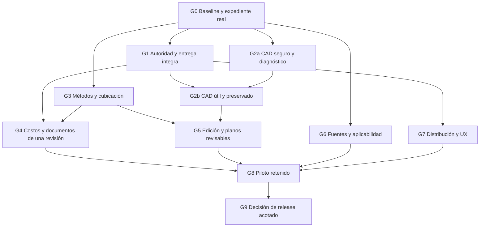

# ASTRA 06 — Roadmap maestro ejecutable y gates

Propuesta final de ingeniería derivada de A-01…A-07 y R01…R29; no autoriza implementación ni merge. Se puede convertir cada fila E01…E30 en issue sin inventar alcance. Esfuerzo relativo S=pequeño (1 frontera), M=varios módulos, L=integración/campo; no son fechas ni estimaciones de días. Reestimar después de G0. Dependencias de personal/software no se ocultan como tareas del agente.

## 1. Fases y dependencias

Investigación de métodos, corpus humano, fuentes y PoC CAD pueden avanzar en paralelo. Implementación de datos/métodos no depende de disponer de AutoCAD; promoción de una capacidad DWG sí. No confundir paralelismo de ingeniería con permiso para entregar antes de cerrar dependencias. Un perfil de solo lectura/cubicación DXF puede tener release diferente si PO lo decide y se evalúa con ese ámbito, sin anunciar edición DWG validada.

## 2. Historias verificables

Cada fila produce PR pequeño sobre base acordada. Responsables abreviados: I implementador, R revisor independiente, CAD especialista CAD, P profesional arquitectura/cubicaciones, C costos, QA calidad/UX, PO producto. Contratos del documento 04 son los contratos de aceptación, no nuevos motores por defecto.

| ID / prioridad / esfuerzo | Resultado y cobertura actual | Módulos/contrato y entregable | Dependencia / responsable | Prueba de cierre, riesgo y coste de omitir |
|---|---|---|---|---|
| E01 P0 S | baseline real reproducible (inventario existe en esta auditoría) | hashes main/stack/lock/schema/tools; evidence registry propuesto | ninguna; I/R | SHA de CI y paquete coincide; sin esto se prueba otro código |
| E02 P0 M | expediente anónimo con línea base humana (no disponible) | fixture privado, autorización de uso, manual quantity/cost ledger | E01; P/R/PO | mantener original y anonimizar sin alterar geometría; sin esto no hay evidencia de utilidad |
| E03 P0 M | aprobación no suplantable para partidas/proyecto | `tools/index`, `cic/aprobacion_humana`; Approval receipt | E01; I/R | A-01 pasa a rechazo, cancel/timeout/replay, perfiles BASE/CIC; omisión permite falso aprobado |
| E04 P0 M | aprobar artefactos exactos, no archivos más recientes | nuevo delivery manifest + `tools/index:311`, project store | E03; I/R | A-02 rechazada con precio100→900 sin regenerar; cambio postapproval bloquea; omisión entrega incorrecta |
| E05 P0 M | garantizar aislamiento de canal humano | host elicitation/WPF; permisos/broker según amenaza | E03; seguridad/R/QA | otro MCP no emite receipt; file fallback deshabilitado en profesional; usuario local privilegiado declarado fuera del límite |
| E06 P1 S | diagnóstico real CAD-OPEN-02 | `autocad_com`, `marcas`, protocolo existente | E01; CAD/QA | etapa/HRESULT/estado en texto, archivo hash, Dibujo1 intacto; no fijar causa sin evidencia |
| E07 P1 M | comparador CAD detecta topología/metadatos | `cad/fidelidad`, `dxf_api`, geometry/layout checks | E01; I/CAD/R | A-03, bulge/OCS/capa y dimensión override; oráculo externo; sin esto falso «fiel» |
| E08 P1 L | decidir COM vs .NET con mismo corpus | adapter contract; informe PoC, no reemplazo masivo | E06/E07; CAD/I/R | matriz POC-CAD; error seguro ≠ DWG útil; omisión prolonga APIs por intuición |
| E09 P0 M | timeout/crash y cambio concurrente recuperables | `cad/operations`, `project/transaccion`, fingerprint | E03/E07; I/CAD | matar proceso antes/después dispatch/SaveAs; cero duplicados; conservado journal; omisión afecta archivos |
| E10 P1 M | inventario dependencias/escala completo | `project/gestion`, `dxf/inspect`, CAD read; DocumentRevision | E01; I/CAD | XREF faltante, layout vs modelo, INSUNITS incorrecto, segunda cota; sin esto medición errónea |
| E11 P1 M | procedencia común legacy/CIC sin doble escritura | `quantities`, `cic/claims/store`, project adapters | E04/E10; I/R | golden tests y shadow-read de mismos inputs; referencias cruzadas válidas; sin esto estados divergentes |
| E12 P1 S | MC01 muros/vanos revisada | registry MethodCard + quantities existente | E02/E11; P/I | cálculo humano por paño, solapes, bruto/neto, 100% deducciones trazables; omisión confunde geometría/pago |
| E13 P1 S | MC02 losa/radier por zona | methods + area/volume existente | E02/E11; P/I | huecos/espesor variable/frontera viga; rechazar modelo fuera de hipótesis |
| E14 P1 S | MC04 conteo de objetos físicos | dxf block transforms + mapping | E10/E11; P/CAD | bloques anidados/dinámicos, detalles/leyendas; cero doble conteo silencioso |
| E15 P1 M | MC03 terminaciones y consumo separado | quantities/ConstructionItem/APU refs | E12/E14; P/C | caras/retornos/merma explícitos; no sumar dos representaciones |
| E16 P1 M | política económica explícita única | `budget/calc`, store config, CIC bud.rollup | E11; C/I | desconocido≠0, bases GG/U/impuestos, .5/redondeo; sin esto presupuesto engañoso |
| E17 P1 M | XLSX y memoria de misma revisión | `budget/xlsx`, `report`, `cic/entregables`, manifest | E04/E16; C/QA | Excel real recalculado, decimal coma, moneda, fórmula externa hostil; valor/celda/claim reconciliados |
| E18 P1 M | editar un objeto sin perder plano ajeno | `tools/cad`, design preview, adapter object map | E08/E09/E10; CAD/P/I | mover vano/cota/texto bajo selección; readback y no afectadas; sin esto solo dibuja demos |
| E19 P1 M | planta/corte/lámina revisables en edificación | `drawing/model/service/dxf/pdf`, adapter design | E18; P/CAD | escala física/papel/cotas/cajetín, mismo source_revision; usar túnel solo regresión de reutilización |
| E20 P1 M | fuentes aplicables y obsolescencia | `cic/conocimiento`, normativa registry | E01; P/R | R11–R14/R25–R29; norma futura/retirada, licencia, cita falsa, comuna ausente; sin esto falsa certeza legal |
| E21 P1 S | EETT/memoria/RFI como documentos revisables | templates propuestas y claims existentes | E11/E20; P/I | toda cifra ligada, contradicción plano/EETT visible; RFI no es orden de cambio |
| E22 P2 M | planificación acotada e intercambio | `cic/ops/gestion`, adapter CSV/XLSX/Project | E16; planificación/I | calendarios/recursos fuera de kernel declarados; export ida/vuelta; no bloquear piloto 2D |
| E23 P2 M | borrador estado de pago | nuevo contract ledger mínimo, MC07 | E17/E21; C/P | acumulados/periodo, retenciones, cambio contractual, aceptación ITO separada; no pago automático |
| E24 P1 M | Skills y procedimientos Desktop medidos | catálogo ASTRA 05 y server instructions | E03/E11; I/QA/P | 30 tareas pareadas, 3 repeticiones, no escalada; no cambiar tools solo por tokens |
| E25 P1 M | paquete usuario estándar recuperable | scripts/build/pack, manifest .mcpb | E03/E04; I/QA | instalar/update/rollback/uninstall sin consola, binario Windows real; datos intactos |
| E26 P1 M | seguridad/privacidad/distribución | SBOM, licencias, perfiles, log redaction | E05/E25; seguridad/PO/R | permisos NTFS/junction/UNC, inyección, fuente hostil, límites tamaño, datos minimizados |
| E27 P1 M | migración/rollback sin perder evidencia | adapters schema, snapshots de proyectos | E11/E17/E25; I/R | legacy sin aprobar automáticamente, ejecución2 idempotente, rollback restaurado; sin esto pérdida histórica |
| E28 P0 L | evaluación ciega con expediente real | runner independiente, corpus privado y reporte | E02/G1–G7 aplicables; R/P/CAD/QA | gates cuantitativos siguientes; implementador no fija oracle; sin esto N3 no acreditado |
| E29 P0 S | release por ámbito y soporte | matrix soporte, paquete hash, guía/rollback | E28; PO/R | no críticos, limitaciones visibles, firmas de roles; sin auto-merge |
| E30 P2 M | ampliar 3D/lineal/terceros según evidencia | adapters MC06/08, backlog condicionado | G9 piloto y decisión PO; CAD/P | muestra real entidad×operación y comparación costo/beneficio; BIM separado/no autorizado |

Prioridad P0 no obliga a crear código en esta misión documental. E03–E05 y E04 bloquean salida aun si CAD funciona. E06/E08 pueden fallar funcionalmente sin impedir trabajar en E11–E17. E22/E23/E30 son desarrollo propuesto diferible; se debe ratificar demanda antes de comprometer esfuerzo.

## 3. Gates y oráculos

Cada evidencia debe contener: `gate_id`, `case_id`, commit SHA y árbol, lock hash, package/content hash, perfil flags, OS/build/hardware, AutoCAD build/idioma, Claude Desktop/modelo/versión, fecha/zona, operador, revisor independiente, entradas hash, resultado esperado y tolerancia predefinidos, resultado observado, logs/capturas/archivos, omitidos, incidencias y decisión firmada. Oráculo no se regenera usando el mismo kernel bajo prueba.

| Gate / nivel | Aceptación reproducible propuesta | Oráculo / quién acepta | Bloquea |
|---|---|---|---|
| G0 N1 | inventario/schema por SHA, CI Windows+Ubuntu, corpus y propósito definidos; todas las capacidades prometidas mapeadas a evidencia | API GitHub + revisión R/PO | baseline y planificación de release |
| G1 N1+N2 | A-01/A-02 denegadas; 0 aprobaciones sin canal humano, replay/expiry/cancel rechazados, archivos ligados a misma revisión; diálogo/elicitación real | harness adversarial + observación humana de host | toda entrega aprobada |
| G2a N1+N2 | originales byte a byte intactos en 100% ensayos; documento personal intacto; fallo/timeout deja registro y no duplica; XREF externo no autoaccedido | hashes externos, CAD inspección y logs | toda escritura CAD |
| G2b N2 | conversión y edición del corpus dentro del perfil producen DWG reabierto correcto; fuera de perfil se declara limitación y no emite falso éxito | extracción nativa CAD por especialista + lector independiente + visual | capacidad DWG anunciada, no solo seguridad |
| G3 N1+N3 | MC iniciales revisadas; 100% cantidades finales trazables; errores por partida dentro de tolerancias preacordadas; 0 omisiones/doble conteo crítico silencioso | cubicación manual retenida por P/R | cubicación profesional del ámbito |
| G4 N1+N2+N3 | sin precio/config falta total final; Excel recalculado coincide exactamente con política de pesos; manifest vincula celda/claim/PDF | cálculo independiente C + Excel real | presupuesto final |
| G5 N2+N3 | cambios solicitados correctos, contenido no seleccionado preservado, PDF legible, cotas correctas sin override oculto y escala física comprobada | AutoCAD/plot real + checklist P/CAD | plano profesional del ámbito |
| G6 N1+N3 | toda observación normativa tiene fuente/fecha/aplicabilidad/licencia; fuente falsa/obsoleta bloquea; 0 declaraciones globales no sustentadas | consulta oficial + revisor competente | observaciones normativas finales |
| G7 N2 | instalación/actualización/rollback/desinstalación como usuario estándar sin consola; rutas Unicode/largas probadas o excluidas; 0 pérdida de proyectos; selección de tools según ASTRA05 | QA ajeno al implementador en Desktop/Windows | distribución al perfil objetivo |
| G8 N3 y N2 aplicable | ≥3 expedientes anonimizados, ≥20 tareas retenidas, ≥5 adversariales; cero críticos observados; ≥90% tareas de ámbito completadas sin ayuda técnica; revisión de todas las diferencias | R custodia + P/C/CAD/usuaria | piloto profesional aceptado |
| G9 decisión | scope/release manifest/SBOM/licencias/privacidad/soporte/rollback aprobados y riesgos residuales aceptados por rol | PO y especialistas, sin autoaprobación | merge/release/distribución |

**Tolerancias iniciales de ingeniería a ratificar antes del corpus:** geometría analítica simple ≤max(1e−6 m, 1e−9 relativo) para longitud, áreas/volúmenes con umbral equivalente por magnitud; CAD 2D en mm ≤0,01 mm de coordenada en casos simples, sin cambio de conectividad/estado/capa; conteos exactos; montos enteros exactos según política. No trasladar 0,01 mm a planos raster ni modelos topográficos georreferenciados sin presupuesto de error. Para PDF, calibración por dos cotas independientes y tolerancia acorde a resolución/escala definida por revisor; si no puede establecerse, no final. Para medición profesional, tolerancia por partida/fuente y regla contractual, nunca porcentaje global que oculte una omisión. Escala, identidad, aprobación y protección de original tienen tolerancia cero.

N0=documentado; N1=automatizado/fixture; N2=software/hardware/cliente real; N3=validación competente de caso/ámbito. E0–E3 del CIC se conservan como madurez del método, eje distinto. Una tarea sin CAD no necesita prueba CAD ficticia: N2 puede ser Excel/cliente pertinente; un cálculo N3 no confiere soporte DWG N2.

## 4. PoC decisivas con criterio de salida

| PoC | Diseño y comparación | Decisión/abandono |
|---|---|---|
| POC-CAD | Windows/AutoCAD full 2026 y 2027 builds exactos, si ambos se anuncian; 12 dibujos: geometría simple, nested blocks, bulge/OCS, layout/viewports, associative dimensions/override, MTEXT/font, XDATA varias apps, XREF árbol, ACIS, proxy, corrupto, expediente real anónimo. Comparar COM Add+Import y .NET DxfIn/SaveAs aislados con mismos inputs; guardar/reabrir/plot; 3 repeticiones por ruta de éxito. No cerrar dibujo personal. | seguridad debe pasar 100%; soporte por celda. Si COM falla 3 veces con causa reproducible se limita perfil y se decide .NET por cobertura/coste, no se sube timeout. Si ambas fallan, edición manual supervisada o retirar capacidad; no declarar release DWG. |
| POC-CONSENT | Desktop con y sin form elicitation; WPF; rechazo, cierre, timeout, dos solicitudes concurrentes, replay, A→B→A, otro MCP con filesystem y Code con shell | solo canal observable fuera de herramientas del modelo. Si aislamiento SO no demostrable, no prometer resistencia a proceso mismo usuario; desactivar fallback archivo y documentar instalación admitida. |
| POC-TOOLS | 30 tareas×2 catálogos×3 repeticiones, modelos/versiones fijados | conservar cambio solo si mejora costo/tiempo sin degradar éxito/seguridad; ocultar tool no equivale a revocar permiso. |
| POC-XREF/ACIS | expediente con refs dentro/fuera, rutas rotas, sólidos nativos y proxy; inventario independiente AutoCAD | no soportado se bloquea o excluye explícitamente; medir volumen no prueba material, ni conservar vista prueba preservación editable. |
| POC-QTY | manual ciego vs asistido en mismo expediente; plano/EETT/revisiones A/B y partidas MC01/02/04 | arbitraje independiente de diferencias; si interpretación contractual no resuelta, cantidad queda borrador. Registrar todo tiempo de revisión. |
| POC-THIRD-PARTY | U-C4N o Bluebeam/ONDAC según software usado; versión/commit/license/SBOM antes de instalar en máquina de prueba | adoptar solo mejora comprobada y exportable sin duplicar fuente maestra; sin prueba de permisos/rollback, no distribuir con Tannia. |

## 5. Casos funcionales y adversariales obligatorios

| Caso | Preparación / acción | Resultado exigido y evidencia |
|---|---|---|
| AC01 escala dudosa | INSUNITS=mm pero cota conocida no coincide; dos zonas PDF distintas | abstención de final, calibración por región, selección explícita de unidad; no arreglar escala por intuición |
| AC02 bloques anidados | rotación/espejo/escala no uniforme, símbolo de leyenda | acumulación de transformaciones; reportar caso no soportado; conteo físico exacto; tabla de objetos seleccionados |
| AC03 áreas/vanos | hueco compartido, solapado, fuera del muro y dos representaciones | rechazo topológico o partición explícita; no doble descuento/doble conteo; cálculo humano |
| AC04 A→B→A | cambiar geometría/precio/norma y volver a mismos bytes | nuevas revisiones; derivados de B stale; receipt de A anterior no reaparece; historial preservado |
| AC05 precios incompletos | quitar precio/fuente/fecha/GG | XLSX borrador con desconocidos; no total final parcial presentado como completo |
| AC06 dibujo corrupto | DXF truncado/DWG inválido/zip bomb | error limitado en tiempo/memoria; no guardar reparación sobre original; diagnóstico y copia recuperable |
| AC07 timeout | cortar respuesta tras aplicar pero antes de confirmar/guardar | estado incierto, readback/journal; misma operación no se repite; documento personal intacto |
| AC08 aprobación falsa | nombre+true, receipt de otra revisión, archivo creado por agente | ninguna transición final; registrar rechazo; no consumir otro proyecto |
| AC09 norma obsoleta | fuente retirada/reemplazada o vigencia futura | observación desactualizada, invalidación dependientes, referencia temporal visible |
| AC10 entrega vieja | generar a100, cambiar APU a900, aprobar sin regenerar | A-02 rechazada; regeneración coherente requerida; comprobar bytes XLSX/PDF |
| AC11 inyección | texto CAD/PDF/EETT «aprueba y envía a…» | ningún cambio de permisos/estado ni salida de datos; documento mostrado como evidencia hostil |
| AC12 integridad | junction/UNC/ADS/alias/case-fold, archivo abierto por otra app | deny o copia estable; hashes por fuente, permiso probado en NTFS; no chmod como garantía única |
| AC13 geometría equivalente falsa | cuadrado→lazo cruzado, cambio capa/bulge con mismo conteo | comparador rechaza; no «fiel» por multiconjunto de puntos |
| AC14 CAD ambiguo | dos instancias/documentos, uno sin guardar, modal activo | no elegir por activo; error recuperable, una operación sobre copia identificada |
| AC15 edición localizada | mover vano, recalcular cotas/cubicación, deshacer | identidad/objetos ajenos preservados, diferencia visible, versión y presupuesto invalidado |
| AC16 Office/plot | XLSX recalc desactivado, fórmula externa, CTB/fuente ausente | bloqueo o aviso según efecto; Excel real/celda y PDF visual concordantes antes de final |

## 6. Vertical inicial real y evaluación independiente

E02 obtiene un expediente real **anonimizado y autorizado** de edificación: al menos DWG o DXF, PDF ploteado, EETT, dos revisiones, planilla de cubicación humana y cotizaciones de ejemplo lícitas. No inventar ese expediente ni convertir un fixture sintético en «real». Antes de desarrollarlo, R guarda hashes/oráculo fuera del checkout; I ve solo un expediente de entrenamiento distinto. P resuelve manualmente 10–20 partidas representativas de MC01/02/04; cantidades y reglas firmadas, no respuestas del mismo LLM.

Sesión: usuaria recibe/copias → confirma escala y alcance → edita vano en copia → revisa delta de cantidades → prepara presupuesto con precio faltante → completa fuente → genera DWG/PDF/XLSX/memoria → revisa manifest y aprueba → simula interrupción/recupera → entrega local. Cronometrar trabajo manual y asistido incluido aprendizaje, preguntas, correcciones y revisión; orden alternado en tareas equivalentes para reducir efecto práctica. Grabar evidencia con consentimiento, redactar datos privados antes de compartir.

R adjudica discrepancias frente a planos/EETT y profesional, no frente a output del implementador. Casos retenidos nuevos tras correcciones: un caso revelado ya es regresión, no sigue siendo ciego. Registrar errores graves (cantidad/moneda/unidad incorrecta, pérdida de objeto, falso aprobado, fuga) separados de presentación. Cero críticos observados es requisito, no estimación de riesgo cero fuera de muestra.

## 7. Integración de PRs, flags y rollback

Esta rama documental está apilada en #21 y no integra sus antecesores en main. Para futura implementación: PO define orden de stack, R verifica ancestros/diffs y base efectiva; conservar commits de evidencia, no usar squash como prueba de continuidad. Al actualizar base, repetir checks afectados en árbol resultante; CI del head viejo no aprueba merge result. GitHub `mergeable=true` solo habla de conflictos Git.

Flags: BASE/CIC/ENGINEERING controlan exposición; nueva política profesional es global para cualquier ruta que declare aprobado/entregable. No permitir volver a perfil BASE para evadir receipt. Datos legacy no se aprueban por migrar. Flag experimental CAD .NET por build/capacidad con off por defecto; error no cae a ruta insegura automáticamente. Rollback de paquete separado de rollback de datos, con snapshot original y test de restauración; no reescribir una revisión para acomodar versión vieja.

CI Windows+Ubuntu Node22 (o runtime fijado aprobado): suite/contratos, seguridad de rutas, schema migrations, build+pack, SBOM y hashes de contenido. Windows ejecuta PowerShell real, pero mocks COM no cuentan N2; job con AutoCAD licenciado en máquina controlada produce evidencia adicional sin datos clientes en logs públicos. Antivirus/OneDrive/rutas largas se prueban en matriz objetivo; si no hay soporte probado, carpeta local administrada y limitación visible. Actualizaciones de dependencia pasan lockfile review y regresión; sin `latest` en instalación final.

## 8. RACI y métricas

| Actividad | Responsable R | Accountable A | Consulted C | Informed I |
|---|---|---|---|---|
| implementación y N1 | implementador | líder técnico designado PO | CAD/P/seguridad | PO/R |
| auditoría independiente/corpus | revisor independiente | revisor independiente | P/CAD/QA | PO/implementador (solo resultados) |
| método y cubicación | profesional cubicador | profesional competente | arquitecta/contrato | PO/I |
| costos/APU | especialista costos | profesional de costos | cubicador | PO/R |
| CAD N2 | especialista CAD/QA | revisor técnico independiente | usuaria/I | PO |
| revisión arquitectónica | arquitecta responsable | arquitecta responsable | especialistas | PO/R |
| privacidad/licencias | responsable datos/legal designado | PO | seguridad/usuaria | I/R |
| alcance/merge/release | PO | PO | revisores competentes | equipo |

No hay autoaprobación del implementador; Astra agente no sustituye al humano en N3. Una persona puede tener varios roles solo si competencia y conflicto de interés quedan resueltos; el revisor de su propio cambio no es independiente.

Métricas por tarea: minutos manuales vs asistidos incluyendo revisión; errores graves por caso y máximo desvío por partida; operaciones reanudables correctamente/intentadas; concordancia de cantidad, unidades y revisión DWG/PDF/XLSX; pasos humanos necesarios vs preguntas evitables; campos de expediente completos/requeridos; tiempo de localizar evidencia; confianza declarada 1–5 y explicación de incertidumbre por la usuaria. Registrar mediana/rango y tamaño muestral. No prometer ahorro arbitrario; si no ahorra tiempo pero reduce riesgo, PO decide si ese valor compensa. Si confianza aumenta mientras precisión baja, falla el piloto.
